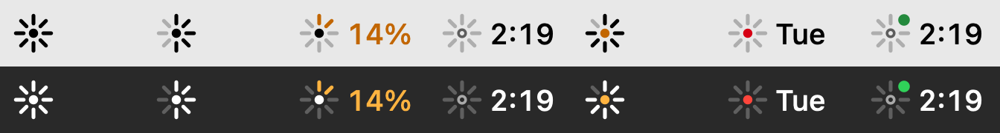

# Headroom

A small spark in your macOS menu bar that shows how much Claude usage you have left, across all your Claude accounts, and when each limit resets.



## Reading the icon

- **Rays** are your 5-hour session. There are 8, each worth 12.5%, and they go out clockwise as you use it.
- **The core** is your week. It turns amber when 15% or less is left, and red when the weekly limit is hit.
- **Amber rays and a %** mean you're running hot: 20% or less left, or using it faster than the 5 hours allow.
- **A dark spark with a countdown** means you hit the session limit. The countdown shows when it comes back.
- **A green dot** means this account is limited or running hot, but another account still has more than half its session left.
- **A question mark** means Headroom couldn't read your usage. It never shows a guessed number.

Click the spark to see every account with its session and weekly bars, per-model limits, and a list of upcoming resets. A tick on each bar marks where you'd be at an even pace.

Headroom can notify you when an account runs hot, hits a limit, or refills after one. Each notification fires at most once per window.

## Install

You need macOS 14 or later and the Command Line Tools (`xcode-select --install`). Xcode isn't required.

```sh
git clone https://github.com/Japabu/headroom.git
cd headroom
./build.sh install
```

This builds `Headroom.app`, copies it to `~/Applications`, and starts it. It also adds itself as a login item; you can turn that off in Settings.

## Multiple accounts

Log in to each account once with `/login` in Claude Code. Headroom notices which account each login belongs to and remembers it. It keeps a copy of the login in the keychain, so it can keep tracking an account after you `/login` to a different one. If that copy stops working, for example after `/logout`, the account stays in the menu with its last known numbers and reset times.

Separate config folders (`CLAUDE_CONFIG_DIR`) work too. Headroom picks up the login in each one.

## Where the data comes from

- **Usage numbers:** Anthropic's `api.anthropic.com/api/oauth/usage` endpoint, the same one Claude Code's `/usage` uses. The numbers include claude.ai and the desktop app, not only Claude Code.
- **Logins:** the macOS Keychain entries Claude Code already created. Headroom reads them through `/usr/bin/security`, the same way Claude Code does, so there are no keychain prompts.
- **Whose login it is:** `api.anthropic.com/api/oauth/profile`, asked once each time a login's token changes.
- **Which account is in use:** the one logged in where Claude Code was active most recently, from its `sessions/` folder and `history.jsonl`.

Headroom checks the account in use every 2 minutes and the others every 10 minutes. It has no server and no analytics. The only other network request is to Anthropic, to renew an expired login.

### Expired logins

Claude Code renews its own login when you use it. For an account you haven't used in a while, Headroom renews the login and saves it back where it came from. It never renews a login that Claude Code is currently logged in to while a Claude Code session is open, and it only uses its own saved copy for accounts Claude Code is no longer logged in to, so it never competes with Claude Code for the same token. You can turn renewing off in Settings.

## Troubleshooting

`build/Headroom-bin --dump` prints the logins Headroom finds and the usage it reads, without tokens. It doesn't renew anything or send notifications.

## Disclaimer

Headroom is an unofficial tool. It isn't affiliated with or endorsed by Anthropic. The usage endpoint isn't a published API and may change without notice. If it does, Headroom shows a question mark until it's updated.

## License

MIT
